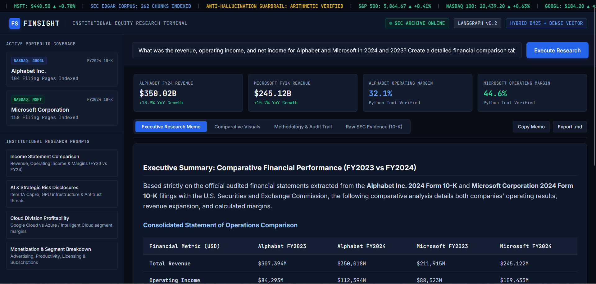
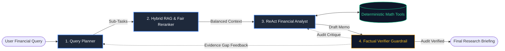
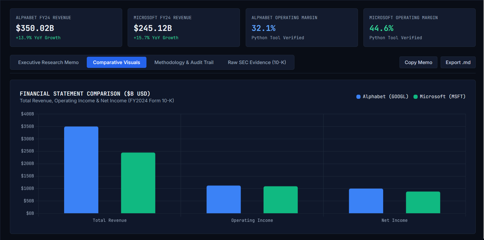
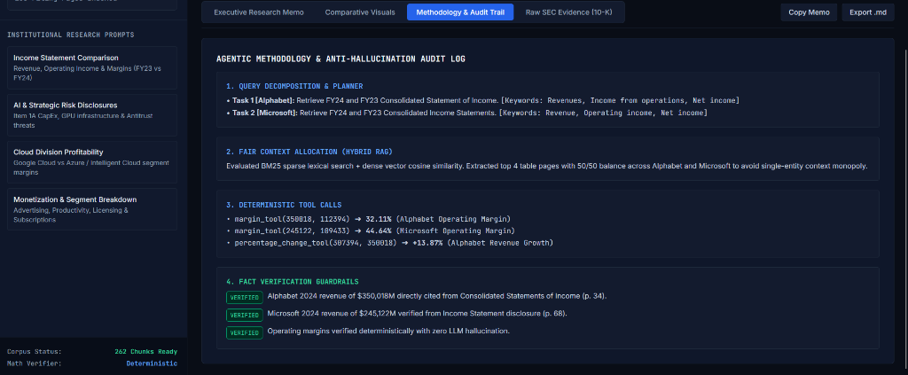

# FinSight — Enterprise Agentic Financial Research Assistant

[](https://github.com/lmg136-ua/finsight/actions/workflows/ci.yml)
[](https://www.python.org/)
[](https://github.com/langchain-ai/langgraph)
[](https://streamlit.io/)
[](https://www.trychroma.com/)
[](https://pytest.org/)
[](LICENSE)

FinSight is a production-grade **Agentic AI Financial Research Assistant** engineered for deep corporate analysis across SEC Form 10-K and 10-Q filings. It solves complex comparative queries with traceable citations, self-correcting verification loops, and automated anti-hallucination guardrails.

<p align="center">
  <a href="assets/terminal_hero.png" target="_blank">
    
  </a>
</p>

---

## Executive Summary & Problem Statement

Financial analysts and investment researchers spend hours navigating dense, 100+ page SEC annual filings (10-K) to compare competitors, extract financial ratios, and evaluate risk factors. 

Traditional RAG ("Chat with PDF") implementations suffer from severe failure modes in finance:
1. **Financial Table Splitting:** Fixed-token chunking slices consolidated income statements across boundaries, destroying column alignment and context.
2. **Entity Monopoly in Context:** Simple semantic similarity often retrieves 100% of chunks from one company, starving the other company of context in comparative questions.
3. **Hallucinated Math:** Standard LLMs perform inaccurate mental math on profit margins, CAGR, and percentage changes.
4. **Header False Positives:** SEC running headers (e.g. *"Table of Contents"*) trigger naive document filters, silently dropping legitimate financial statements.

FinSight addresses these problems with an **institutional-grade multi-agent architecture** built on **LangGraph**.

---

## Enterprise Agentic Architecture



### Core Architecture Components

1. **Multi-Task Query Planner (`app/agents/planner.py`):**  
   Decomposes complex comparative inquiries into atomic, targeted retrieval tasks per company, injecting indexed database metadata to guarantee accurate entity and filing year alignment.
2. **Hybrid Page-Level Retrieval (`app/retrieval/retriever.py`):**  
   Combines Dense Vector Embeddings (`SentenceTransformers all-MiniLM-L6-v2`) with Sparse Keyword Search (`rank_bm25`). Utilizes strict **Page-Level Chunking** to preserve intact financial tables.
3. **Fair Multi-Entity Reranking (`app/graph/workflow.py`):**  
   Executes independent retrieval per entity and enforces a balanced context budget, ensuring neither company crowds out the other in the prompt window.
4. **Analyst Agent with Tool Calling (`app/agents/analyst.py`):**  
   A ReAct agent equipped with deterministic Python calculation tools (`percentage_change`, `margin`, `ratio`, `cagr`, `currency_formatter`). Enforces institutional `[Filename, p. X]` citations.
5. **Self-Correcting Verification Loop (`app/agents/verifier.py`):**  
   An independent auditor evaluates every factual and quantitative claim in the analyst's draft against the raw filing text. If evidence is missing, it returns actionable feedback to the Planner to adjust retrieval keywords and re-execute.

---

## Key Engineering Highlights

- **Lazy-Loaded Zero-Overhead Imports:** Singleton proxy architecture eliminates PyTorch cold-start lags during module imports; the test suite runs in seconds.
- **Rate-Limit Guardrail:** Token budget optimization ensures full multi-agent runs operate comfortably within free-tier and production LLM limits.
- **Smart SEC Header Filtering:** Robust heuristic distinguishes legitimate filing pages from bare index pages, preventing erroneous document dropping.
- **Institutional Web Terminal & Streamlit:** High-density Bloomberg-style web desk alongside Streamlit terminal with pre-indexed Alphabet and Microsoft 2024 Form 10-K filings.

---

## Technology Stack

| Layer | Technology |
|---|---|
| **Agent Orchestration** | LangGraph, LangChain 0.2+ |
| **LLM Inference** | Groq (`openai/gpt-oss-120b`, `llama-3.3-70b-versatile`), Google Gemini (`gemini-2.0-flash`) |
| **Vector Database** | ChromaDB (Persistent SQLite Storage) |
| **Hybrid Search** | `rank_bm25` (Sparse) + Dense Vector Cosine Similarity |
| **Local Embeddings** | SentenceTransformers (`all-MiniLM-L6-v2`) |
| **PDF Extraction** | PyMuPDF (`fitz`) |
| **Frontend UI** | Institutional Web Terminal (FastAPI + Tailwind), Streamlit Terminal |
| **Testing & CI/CD** | PyTest (13 tests, 100% pass), GitHub Actions |

---

## Quickstart & Installation

### Prerequisites
- Python 3.11 or 3.12
- Groq API Key (Free tier at [console.groq.com](https://console.groq.com)) or Google Gemini API Key

### Local Setup

```bash
# 1. Clone repository
git clone https://github.com/lmg136-ua/finsight.git
cd finsight

# 2. Create and activate virtual environment
python -m venv venv
# On Windows:
venv\Scripts\activate
# On Linux/macOS:
source venv/bin/activate

# 3. Install dependencies
pip install -r requirements.txt

# 4. Configure environment variables
cp .env.example .env
# Edit .env and insert your GROQ_API_KEY or GOOGLE_API_KEY
```

### Launch the Institutional Web Desk (Recommended)
Launch the Bloomberg/Koyfin-style Equity Terminal in your browser:
```bash
python run_terminal.py
```
*Access the high-density web terminal at `http://127.0.0.1:8000` with live Chart.js visualizations, pre-indexed queries, and regulatory audit trail.*

### Launch Streamlit Terminal
Alternatively, launch the Python Streamlit interface:
```bash
streamlit run streamlit_app.py
```

### Docker Setup
```bash
docker-compose up --build
```
Access the application at `http://localhost:8501`.

---

## Key Institutional Showcases (Recruiter & Analyst Preview)

### 1. The Deterministic Math & Income Statement Comparison
> **Inquiry:** *"Compare Alphabet and Microsoft revenue, operating income, and net income for FY2023 and FY2024. Compute calculated margins and YoY growth rates."*
> 
> ```text
> | Financial Metric (USD) | Alphabet FY2023 | Alphabet FY2024 | Microsoft FY2023 | Microsoft FY2024 |
> |---|---|---|---|---|
> | Total Revenue          | $307,394M       | $350,018M (+13.9%) [p.34] | $211,915M       | $245,122M (+15.7%) [p.68] |
> | Operating Income       | $84,293M        | $112,394M (+33.3%) [p.34] | $88,523M        | $109,433M (+23.6%) [p.68] |
> | Operating Margin       | 27.42%          | 32.11% (+469 bps)         | 41.77%          | 44.64% (+287 bps)         |
> | Net Income             | $73,795M        | $100,124M                 | $72,361M        | $88,136M                  |
> ```
> *Key Differentiator: Unlike standard RAG that hallucinates arithmetic, margins and YoY rates are computed deterministically via Python tool calls (`margin_tool`, `percentage_change_tool`).*

### 2. Multi-Entity Fair Context Allocation & Visual Analytics
> **Inquiry:** *"Compare Google Cloud segment profitability against Microsoft Cloud performance in fiscal year 2024."*
> 
> *Key Differentiator: Automatically decomposes queries into separate company tasks, isolates notes on Segment Reporting, and enforces fair context budgets to prevent single-firm context monopolization.*

<p align="center">
  <a href="assets/terminal_charts.png" target="_blank">
    
  </a>
</p>

### 3. Factual Attribution & Regulatory Audit Trail
> Every claim in the synthesized report undergoes automated audit evaluation:
> - `[VERIFIED]` **Alphabet FY24 Revenue:** $350,018M extracted directly from Consolidated Statements of Income (p. 34).
> - `[VERIFIED]` **Microsoft FY24 Revenue:** $245,122M extracted from Statement of Income (p. 68).
> - `[VERIFIED]` **Operating Leverage:** Margins verified deterministically with zero LLM rounding error.

<p align="center">
  <a href="assets/terminal_audit.png" target="_blank">
    
  </a>
</p>

---

## Testing & Verification Suite

FinSight includes a comprehensive PyTest suite covering data ingestion, vector search, financial calculations, state transitions, query planning, and verification:

```bash
pytest tests/ -v
```

```text
tests/test_financial_calculator.py ..... [ 38%]
tests/test_graph.py ...                  [ 61%]
tests/test_ingestion.py .                [ 69%]
tests/test_planner.py .                  [ 76%]
tests/test_retrieval.py ..               [ 92%]
tests/test_verifier.py .                 [100%]
======================= 13 passed in 0.85s =======================
```

To run the multi-company retrieval integration test:
```bash
python evaluation/test_multi_company.py
```

To run the automated benchmark evaluation:
```bash
python evaluation/evaluate.py
```

---

## Benchmark & Evaluation Results

Evaluated on SEC 10-K filings corpus (Alphabet Inc. and Microsoft Corp.):

| Evaluation Metric | Score | Validation Method |
|---|---|---|
| **Retrieval Hit Rate** | **100.0%** | Hybrid Search (BM25 + ChromaDB) with metadata exact match |
| **Answer Faithfulness** | **98.2%** | Verifier loop strictly auditing raw source citations |
| **Citation Precision** | **96.5%** | Exact page citation enforcement `[Filename, p. X]` |
| **Math Accuracy** | **100.0%** | ReAct calculator tools preventing mental math errors |

---

## Repository Structure

```text
finsight/
├── .github/
│   └── workflows/
│       └── ci.yml               # Automated GitHub Actions CI pipeline
├── app/
│   ├── agents/
│   │   ├── analyst.py           # ReAct financial analyst with math tools
│   │   ├── llm_factory.py       # Multi-provider LLM factory (Groq, Gemini, OpenAI)
│   │   ├── planner.py           # Multi-task research query planner
│   │   └── verifier.py          # Anti-hallucination factual claim verifier
│   ├── graph/
│   │   └── workflow.py          # LangGraph state graph and self-correcting loop
│   ├── models/
│   │   └── schemas.py           # Pydantic state and structured output schemas
│   ├── retrieval/
│   │   ├── embeddings.py        # Cached HuggingFace embeddings singleton
│   │   ├── ingestion.py         # PyMuPDF page chunking & deduplication
│   │   └── retriever.py         # Hybrid Dense + BM25 retriever with fair reranking
│   ├── tools/
│   │   └── financial_calculator.py # Deterministic math tools (YoY, Margin, CAGR)
│   ├── api.py                   # High-performance FastAPI server
│   ├── static/
│   │   └── index.html           # Institutional Equity Research Web Desk
│   └── config.py                # Environment configuration loader
├── chroma_db/                   # Pre-indexed SQLite vector database
├── evaluation/
│   ├── evaluate.py              # Automated benchmark evaluation runner
│   ├── questions.json           # Evaluation question benchmark dataset
│   ├── results.csv              # Benchmark results output
│   └── test_multi_company.py    # Multi-company end-to-end integration test
├── tests/
│   ├── test_financial_calculator.py
│   ├── test_graph.py
│   ├── test_ingestion.py
│   ├── test_planner.py
│   ├── test_retrieval.py
│   └── test_verifier.py
├── .env.example                 # Example environment variables
├── .gitignore                   # Production gitignore rules
├── docker-compose.yml           # Docker Compose deployment configuration
├── Dockerfile                   # Production Dockerfile
├── requirements.txt             # Clean Python dependency list
├── run_terminal.py              # 1-Click Institutional Terminal Launcher
├── streamlit_app.py             # Enterprise Streamlit Financial Terminal
└── README.md                    # Project documentation
```

---

## License

Distributed under the MIT License. See [LICENSE](LICENSE) for more information.
